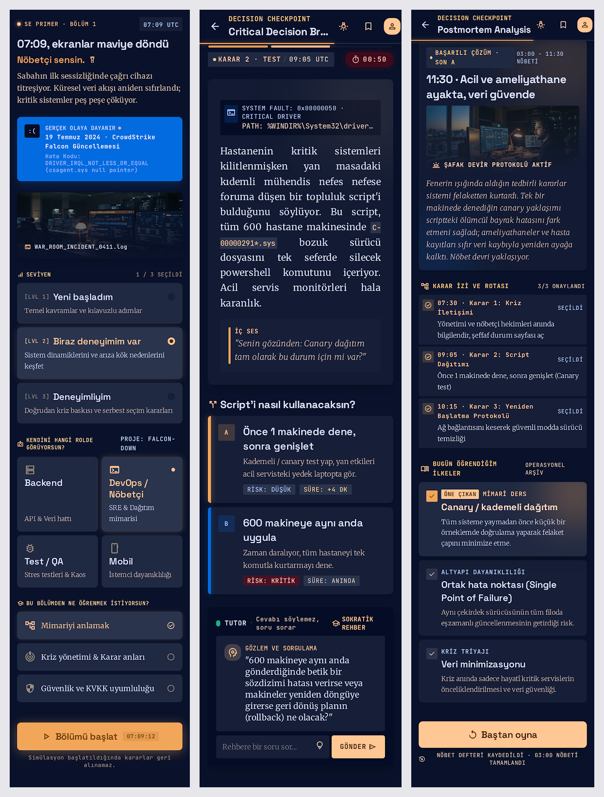

# Stitch çıktıları

Google Stitch'e `design/stitch-prompt.md` içindeki prompt verildi (Mobile). Her ekran Stitch'ten ayrı ayrı dışa aktarıldı: ekran görüntüsü (`.png`), Stitch'in ürettiği kod (`.html`) ve Stitch'in kendi tasarım sistemi (`DESIGN-stitch.md`, adı "Midnight Dispatch").

| # | Ekran | Görüntü | Stitch kodu |
|---|---|---|---|
| 1 | Giriş / profil | [1-giris.png](1-giris.png) | [1-giris.html](1-giris.html) |
| 2 | Karar sahnesi (Karar 2 · Test) | [2-sahne.png](2-sahne.png) | [2-sahne.html](2-sahne.html) |
| 3 | Son (SON A) | [3-son.png](3-son.png) | [3-son.html](3-son.html) |

## Stitch tasarımından uygulamaya ne aldım, neyi almadım

**Aldım (prompt'ta istediğim gibi çıkanlar):** lacivert zemin + fener turuncusu vurgu, kriz kutusu için durma ekranı mavisi, mono saat ve etiketler, tutor panelindeki "Cevabı söylemez, soru sorar" notu, son ekrandaki karar izi ve "Bugün öğrendiğim" kartları.

**Almadım, çünkü yanlış ya da kapsam dışı:**

| Stitch'in eklediği | Neden almadım |
|---|---|
| Giriş ekranında hata kodu `DRIVER_IRQL_NOT_LESS_OR_EQUAL (csagent.sys null pointer)` | Doğrulanmış kök neden bu değil. Olay sırasında "null pointer" yorumları yayıldı; CrowdStrike'ın kök neden analizine göre sensör 20 alan beklerken 21 alan aldı ve sınır dışı bellek okuması oldu. Uygulama doğrulanmış açıklamayı kullanıyor. |
| Sahne ekranında `SYSTEM FAULT: 0x00000050` | Prompt'ta yoktu; Stitch uydurdu. Gerçek olayla bağını doğrulamadığım bir ayrıntıyı öğretim aracına koymadım. |
| Seçeneklerde "RİSK: DÜŞÜK / KRİTİK" etiketleri | Hangi seçeneğin doğru olduğunu ele veriyor. Sokratik tutor ilkesine (spec.md KA-5) ters. |
| Son ekrandaki karar izi metinleri ("Karar 1: Kriz İletişimi", "Karar 3: Yeniden Başlatma Protokolü") | Stitch kendi kararlarını uydurdu; uygulamadaki kararlar spec.md §7'dekiler (Mimari, Test, KVKK). |
| "Simülasyon başlatıldığında kararlar geri alınamaz" | Kapsam dışı; "Baştan oyna" ile her şey sıfırlanıyor. |
| Fotoğraf görselleri | Ağ gerektiriyor, mobilde yavaş; içerik bir şey öğretmiyor. |

**Ders:** Stitch görsel dili iyi yakaladı ama içerikte, özellikle teknik ayrıntılarda, uydurma yaptı. Bir tasarım aracının çıktısı da kod gibi gözden geçirilmeli.

Uygulamanın son hâlindeki ekranlar: `design/1-giris-*.png`, `design/2-sahne-*.png`, `design/3-son-*.png`.
