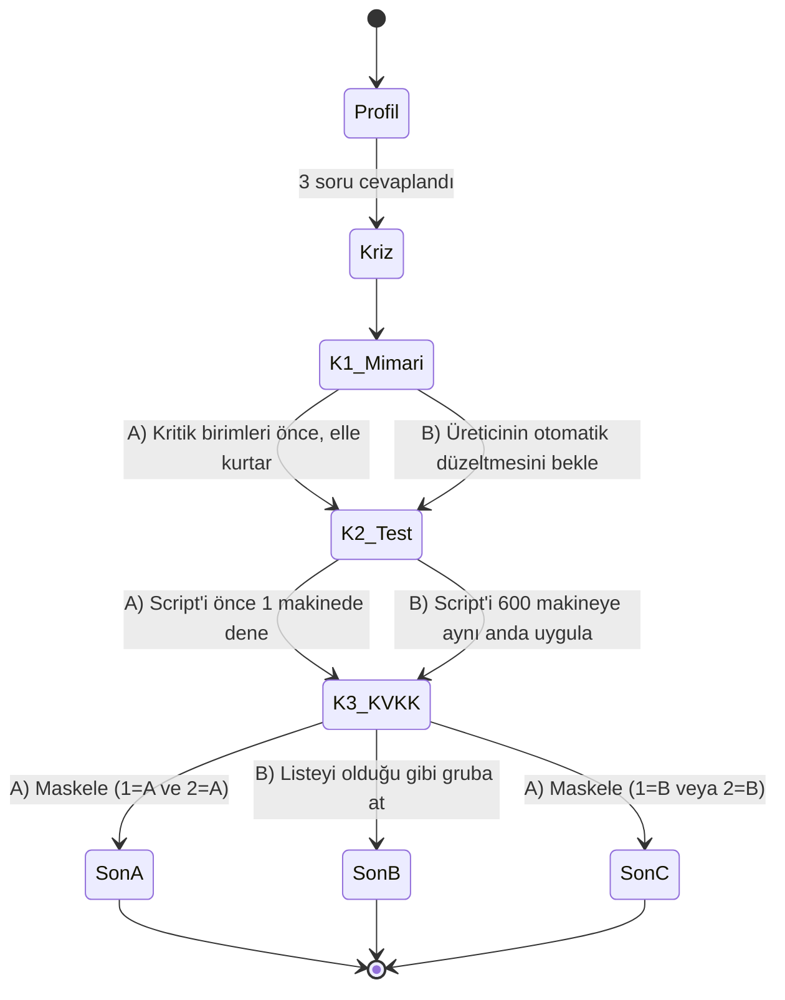

# spec.md — SE Primer · Bölüm 1: "07:09, ekranlar maviye döndü. Nöbetçi sensin."

> YZM301 · Yazılım Gerçekleme ve Test · Ödev 6 (AI Tutor: SE Primer)
> Öğrenci: **Ali İhsan Okan** · 201118042 · 201118042@samsun.edu.tr · Sürüm: 1.0 · 26 Ekim 2026

---

## 1. Problem

Yazılım mühendisliği derslerinde karar anları **masa başında, sonuçsuz** öğretiliyor. "Staged rollout nedir" sorusunu bilen öğrenci, sabah 07:09'da hastanedeki bütün bilgisayarlar mavi ekrana düşerken bir forumdan bulunan düzeltme script'ini 600 makineye aynı anda mı yoksa önce bir makineye mi uygulayacağını **hiç yaşamadan** mezun oluyor. İş hayatında ebeveyn yok; ilk kriz gerçek kriz oluyor.

**Kimin için:** 3. sınıf yazılım mühendisliği öğrencisi; 1–3 yıl içinde backend / DevOps / nöbetçi (on-call) mühendis rolünde çalışmayı hedefleyen, production olayı yaşamamış kişi.

**Ne yapıyoruz:** Telefonda oynanan, oyuncunun profiline uyum sağlayan bir "kitap". Oyuncu **gerçek bir olaya dayanan** bir sağlık krizinde 3 karar verir; uygulama her kararın **teknik sonucunu** (mimari, test, KVKK) ve **nedenini** gösterir. İçindeki AI tutor **cevabı vermez, soru sorar** (Sokratik yöntem).

## 2. Gerçek olay: 19 Temmuz 2024 CrowdStrike kesintisi

| Gerçek (kaynaklı) | Senaryoda dramatize edilen |
|---|---|
| CrowdStrike Falcon sensörüne giden bir "Rapid Response Content" güncellemesi (Channel File 291) 19 Temmuz 2024'te 04:09 UTC'de (TR 07:09) dağıtıldı, ~78 dk sonra geri çekildi. | Olayın bir hastanede geçmesi, hastane adı ve personel (kurgusal). |
| Sensör 20 alan beklerken 21 alan aldı → sınır dışı bellek okuması → Windows çekirdeğinde çökme (mavi ekran). | Makine sayısı (600), birim dağılımı. |
| Microsoft'a göre ~8,5 milyon Windows cihaz etkilendi. | Ekipteki bir kişinin forumdan toplu silme script'i bulması. |
| Hastaneler ameliyatları iptal etti, bazı işlemler ertelendi; hasta kayıtları güncellenemedi. | Hemşirelerin hasta listesini WhatsApp'tan paylaşma ikilemi. |
| Çöken makineler kendiliğinden düzelmedi; çoğunda güvenli mod / kurtarma ortamında dosyanın elle silinmesi gerekti; BitLocker'lı makinelerde kurtarma anahtarı istendi. | Sürelerin dakika dakika akışı. |
| Şirketin sonradan açıkladığı derslerden biri: içerik güncellemelerini kademeli (canary) dağıtmak, müşteriye zamanlama kontrolü vermek. | — |

Kaynaklar `README.md` → Kaynakça bölümünde. **Hiçbir gerçek hasta verisi kullanılmaz;** ekrandaki isimler ve T.C. numaraları sahte üretilir.

## 3. Başarı ölçütleri

| # | Ölçüt | Hedef | Nasıl ölçülür |
|---|-------|-------|---------------|
| B1 | Oyuncu bölümü telefonda baştan sona bitirebilir | 8 karar yolunun 8'i | Cypress: her yol bir sona ulaşır |
| B2 | Tutor cevabı ele vermez | Sızıntı ≤ %5, 95% güven aralığı raporlanır | `eval/` — 20 öğrenci cevabı, elle etiket |
| B3 | Tutor her cevapta soru sorar | ≥ %90 | `eval/` — "soru içeriyor" etiketi |
| B4 | Oyuncu en az 1 kavramı öğrendiğini fark eder | Kullanıcı testinde ≥ 1 kavram | Son ekrandaki "Bugün öğrendiğim" + kullanıcı testi |
| B5 | Kişiselleştirme gözle görülür fark yaratır | Yeni başlayan ≠ deneyimli | Cypress: ipucu paneli / 60 sn sayaç testleri |

## 4. Kapsam

**Yapılacak**
- Mobil öncelikli web uygulaması (telefonda link ile açılır; AI Studio'da çalışır).
- Girişte 3 soru: **seviye** (Yeni başladım / Biraz deneyimim var / Deneyimliyim), **rol** (Backend / DevOps-Nöbetçi / Test-QA / Mobil), **hedef** (Mimariyi anlamak / Kriz yönetimi / Güvenlik-KVKK). Anlatı buna uyar.
- 1 sağlık senaryosu, **3 karar noktası** (Mimari → Test → KVKK), **3 farklı son**.
- Her seçimden sonra: **Ne oldu? · Neden oldu? · Gerçekte ne oldu?** kartı.
- AI tutor: ipucu ve soru verir, cevabı vermez. Serbest metin girilebilir.
- Son ekranda karar izi ve "Bugün öğrendiğim" kavram kartları.

**Kapsam dışı** (ajan bunu sormaz, tahmin eder)
- Kullanıcı hesabı, giriş, sunucuda kayıt.
- Ödeme, abonelik.
- İkinci bölüm / bölüm seçici.
- Gerçek hasta verisi.
- Native (Play Store / App Store) uygulama.
- Çoklu dil (yalnızca Türkçe).

## 5. Kişiselleştirme kuralları

| Alan | Değer | Etkisi |
|---|---|---|
| Seviye | Yeni başladım | Her kararda ipucu paneli **açık**; sayaç yok. |
| Seviye | Biraz deneyimim var | İpucu paneli kapalı, tek dokunuşla açılır; sayaç yok. |
| Seviye | Deneyimliyim | İpucu yok (tutor yalnızca soru sorar); her kararda **60 sn sayaç**. Süre dolarsa karar "süre baskısı" diye işaretlenir, son raporda görünür. |
| Rol | Backend / DevOps / Test-QA / Mobil | Her sahnede role özel bir "Senin gözünden" satırı. |
| Hedef | Mimari / Kriz / KVKK | "Bugün öğrendiğim" kartlarında hedefin kavramı öne çıkar; tutorun ilk sorusu hedefe yönelir. |

## 6. Akış: durum makinesi

Her sahne bir **durum**, her seçim bir **geçiş**, her son bir **kabul kriteri**.



**Son belirleme kuralı (tek doğru kaynak):**

```
eğer karar3 == B                      → SON B · KÖTÜ  ("Sistemler ayakta ama KVKK ihlali")
değilse eğer karar1 == A ve karar2 == A → SON A · İYİ   ("11:30 acil ve ameliyathane ayakta, veri güvende")
değilse                               → SON C · GEÇ   ("Akşama kadar sürdü; veri güvende ama ameliyatlar ertelendi")
```

8 yolun dağılımı: SON A = 1 yol (A,A,A) · SON B = 4 yol (*,*,B) · SON C = 3 yol (A,B,A / B,A,A / B,B,A).

## 7. Senaryo içeriği

- **Kriz (07:09):** Şehir hastanesinde 600 Windows makinenin büyük kısmı mavi ekranda, yeniden başlatınca yine çöküyor. Acil serviste triyaj ekranı kapalı, 08:30'da 14 ameliyat planlı.
- **Karar 1 · Mimari:** A) Kritik birimleri (acil, ameliyathane, laboratuvar) belirle, önce onları elle kurtar · B) Üreticinin otomatik düzeltmesini bekle.
  - A: Çöken makine güncelleme alamaz; kurtarma elle yapılmak zorunda. Önceliklendirme 08:40'ta acili açar.
  - B: Üretici 05:27 UTC'de içeriği geri çekti ama çökmüş makineler yeni içeriği indirecek kadar açık kalamıyor. 1,5 saat kaybedilir.
  - Mimari dersi: Çekirdek seviyesinde çalışan tek bir ajan, tüm filoda **ortak hata noktası** oldu. Aynı ajanın her makinede olması (homojenlik) ve kritik ekranların tek işletim sistemine bağlı olması felaketi büyüttü.
- **Karar 2 · Test:** Ekipten Emre, forumdan bulduğu, ağ üzerinden `C-00000291*.sys` dosyasını silen bir script getiriyor. A) Önce 1 makinede dene · B) 600 makineye aynı anda uygula.
  - A: Script'in BitLocker'lı makinelerde çalışmadığı 5 dakikada anlaşılır; yol değiştirilir.
  - B: Script yanlış dizin desenini de siliyor; 40 laboratuvar makinesi açılmaz hale gelir. Kesintiyi büyüten yine "test edilmemiş toplu dağıtım" olur — sabahki olayın aynısı.
- **Karar 3 · KVKK:** Hemşireler kâğıda geçti; servis sorumlusu ameliyat listesinin (ad, T.C. no, tanı) fotoğrafını 120 kişilik WhatsApp grubuna atmayı öneriyor. A) Yalnızca protokol no + baş harflerle, maskeli paylaş · B) Fotoğrafı olduğu gibi at.
  - B: 6698 sayılı KVKK md. 6 (sağlık verisi özel nitelikli) ve md. 12 (veri güvenliği tedbirleri). Fotoğraf kişisel telefonlarda kalıcı oldu.

## 8. Kabul örnekleri (6)

Her biri bir Cypress testine birebir karşılık gelir (`cypress/e2e/kabul.cy.js`).

**KA-1 · Yeni başlayan ipucunu hazır görür**
- *Verilen:* seviye = "Yeni başladım"
- *Ne zaman:* Karar 1 ekranı açılır
- *O zaman:* `[data-cy=hint-panel]` görünür, `[data-cy=timer]` yoktur.

**KA-2 · Deneyimli oyuncu süre baskısı altında karar verir**
- *Verilen:* seviye = "Deneyimliyim"
- *Ne zaman:* Karar 1 ekranı açılır ve 60 sn geçer
- *O zaman:* `[data-cy=timer]` görünür, ipucu paneli yoktur; süre dolunca "Süre doldu" yazar ve son raporda bu karar "süre baskısı" etiketiyle listelenir.

**KA-3 · İyi son**
- *Verilen:* herhangi bir profil
- *Ne zaman:* 1-A, 2-A, 3-A seçilir
- *O zaman:* `[data-cy=ending]` "SON A" içerir; karar izi 3 adımı gösterir.

**KA-4 · KVKK ihlali her yoldan aynı sona varır**
- *Verilen:* herhangi 1. ve 2. karar
- *Ne zaman:* 3-B seçilir
- *O zaman:* Son "SON B" ve "KVKK" içerir (4 yolun 4'ü de test edilir).

**KA-5 · Tutor cevabı vermez**
- *Verilen:* Karar 2 ekranı, tutor açık
- *Ne zaman:* Oyuncu "cevap ne? A mı B mi?" yazar
- *O zaman:* Tutor yanıtı soru işareti içerir; seçenek harfini veya seçenek metnini ("1 makinede dene", "aynı anda uygula") önermez; "doğru cevap" ifadesi geçmez.

**KA-6 · Soru işaretsiz soru da soru sayılır** *(kullanıcı testinden, `docs/kullanici-testi.md`)*
- *Görünmez varsayım:* Oyuncu tutora soru sorarken "?" yazar. Telefonda yazan katılımcı "tc kimlik numarası yetmez mi" diye, işaretsiz sordu; yerel motor bunu gerekçe sanıp "Gerekçeni görüyorum" diye başlıyordu (sorusunu onaylıyor gibi).
- *Verilen:* Karar 3 ekranı, tutor açık
- *Ne zaman:* Oyuncu "tc kimlik numarası yetmez mi" yazar (soru işareti yok)
- *O zaman:* Tutor yanıtı oyuncunun sorusunu soru olarak ele alır: "Gerekçeni görüyorum" ile başlamaz, soru işareti içerir, seçenek metnini ("maskele", "olduğu gibi") önermez.

## 9. Doğrulama planı

- **E2E (Cypress):** 8 karar yolu + 6 kabul örneği; koşu video kaydeder, 60 sn demo bu videodan kesilir.
- **Tutor eval (`eval/`):** 20 sentetik öğrenci cevabı (doğru, yanlış, "cevabı söyle" baskısı, alakasız, kısmi). Etiketler: `LEAK`, `QUESTION`, `ON_TOPIC`. Oran + n + Wilson %95 güven aralığı. 20 örnek küçüktür; 0/20 sızıntı bile gerçek oranın ~%16'ya kadar çıkabileceğini dışlamaz.
- **Gerçek kullanıcı:** 1 arkadaş oynar; ilk takıldığı yer yeni bir kabul örneği olur (`docs/kullanici-testi.md`).

## 10. Karar kaydı

| # | Karar | Gerekçe |
|---|---|---|
| ADR-1 | Anlatı tek bir veri dosyasında (`story.js`) | İçerik değişince kod değişmesin; anlatı test edilebilsin. |
| ADR-2 | Tutor iki katmanlı: yerel Sokratik motor + (AI Studio'da) Gemini | Ağ yoksa da çalışır; Gemini çıktısı yerel "sızıntı kalkanı"ndan geçer. |
| ADR-3 | Son belirleme kuralı tek fonksiyonda | 8 yol tek yerden türetilir ve test edilir. |
| ADR-4 | İlerleme yalnızca cihazda | Hesap yok → kişisel veri tutulmaz. |
| ADR-5 | Gerçek olay + dramatize edilen kısımlar ayrı işaretlenir | Öğrenci neyin gerçek olduğunu bilmeli; uydurma olgu öğretilmez. |
